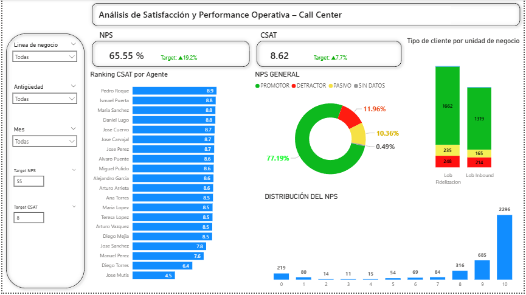
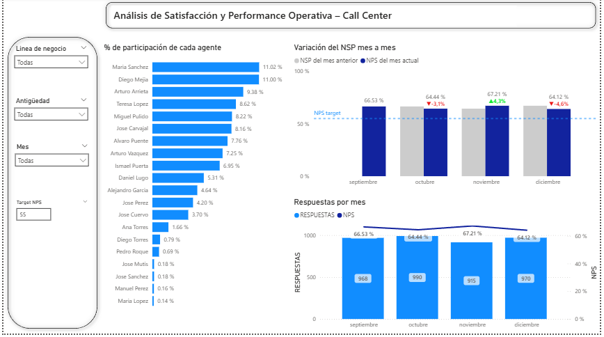

# Proyecto de Análisis de Datos | Análisis de Satisfacción y Performance Operativa – Call Center

### 🖼️ Vista Previa del Dashboard
Implemente graficos para poder obtener un mejor detalle de como se compone el NPS en cada linea de negocio, cree targets dinamicos que se pueden ajustar a la necesidad y que reflejen los requerimientos de la empresa (En esta oportunidad se establecio que el NPS meta era 55% y el CSAT 8). Ademas cree funciones para dar seguimiento a los KPIS y visualizar que tan por debajo o por encima del target se está actualmente.

### 🖼️ Inteligencia de tiempo y otros graficos
Con el grafico 'Variacion del NPS mes a mes' se puede visualizar que tanto % baja o sube el NPS entre los meses, en este caso las variaciones son menores al 5% y siempre estan por el encima del target (esto se cumple para las 2 lineas de negocio existentes). Además hice un grafico de barras horizontales para poder visualizar la participacion de cada agente en la contestacion de las llamadas y un gracico que cuenta la cantidad de respuestas que se recibieron en cada mes.

## Conclusión
Con los datos que se pudieron analizar se pudo verificar que los 2 equipos de distintas lineas de negocio, cumplieron con los KPIS meta establecidos, si bien es cierto que este valor fluctua mes a mes bajando y volviendo a subir, estas variaciones son minimas (menores a un 5% y siempre por encima del target) por lo que se puede concluir que ambos equipos estan obteniendo un rendimiento satisfactorio.